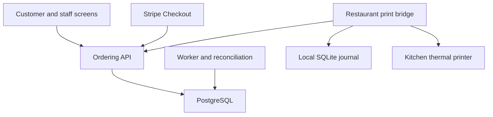

# Wok & Chop — Architecture Essentials

Version 1.0 · 18 November 2026 · Proposed implementation baseline

This is the quick technical orientation for Wok & Chop's online ordering system. [ARCHITECTURE.md](ARCHITECTURE.md) is the canonical technical design; [PRD.md](PRD.md) defines product scope, [SRS.md](SRS.md) defines testable requirements, and [AGENT.md](AGENT.md) guides implementation. This brief describes a system to build, not a verified live installation.

## 1. What the system does

Customers browse the menu, choose modifiers, select ASAP or scheduled pickup, and pay through Stripe. The restaurant receives the verified order in its dashboard/KDS and the kitchen receives an automatically dispatched production ticket when preparation is due. Customer payment receipts and kitchen tickets are separate outputs.

The launch baseline is one location at **790 Kanata Ave, Unit M2A, Kanata ON**, with CAD pricing and **America/Toronto** business time. Delivery stays disabled until separately scoped. Menu, hours, contact details, halal statements, and policies require approved restaurant content.

## 2. Stack and deployment

| Component | Proposed technology and responsibility |
| --- | --- |
| Website and staff screens | Next.js; responsive ordering, tracking, dashboard, KDS |
| API | NestJS/TypeScript; authorization, pricing, availability, order commands |
| Durable database | PostgreSQL; orders, snapshots, reservations, payments, events, print jobs |
| Background processing | Separate worker; Redis/BullMQ wakeups with PostgreSQL-backed recovery |
| Payments | Stripe-hosted Checkout; immediate capture, cards and eligible wallets |
| Restaurant bridge | Always-on Linux service; outbound HTTPS and SQLite dispatch journal |
| Kitchen hardware | Qualified wired 80 mm thermal printer; tested ESC/POS or vendor adapter |

Use a modular monolith with separate API, worker, and bridge processes. Pin supported software, API, firmware, and driver versions during implementation. A qualified CloudPRNT integration is an alternative printing route; build and qualify one production route first.

Redis accelerates work; it is not the order ledger. The bridge receives only authorized station jobs, never database or Stripe credentials. Keep the printer on the restaurant LAN. Printing must not depend on an open browser tab or an internet-exposed printer port.

## 3. Paid order path

1. The server validates selections and calculates a short-lived quote using current menu, tax, and availability rules.
2. Checkout creation reserves capacity/stock, freezes the order snapshot, and persists a payment attempt before contacting Stripe.
3. Stripe session creation uses a stable idempotency key. An uncertain response stays `CREATING` and recovers the same request.
4. A signature-verified webhook is durably stored before acknowledgment. The worker verifies canonical provider state, amount, currency, account, and order linkage.
5. In one database transaction, record verified payment and its receipt obligation; accept eligible fulfillment, commit reservations, and persist kitchen-release events. Paid exceptions still receive payment-received/review wording without a false pickup promise. Duplicate processing produces no duplicate business effect.
6. ASAP work becomes eligible immediately. Scheduled work persists its release time and becomes eligible at preparation time. The bridge claims a job, journals it, obtains dispatch permission, prints, and reports the evidence it actually has.

The customer return page never authorizes fulfillment. Closing the browser after payment must not lose the order. Reconciliation recovers missed or interrupted processing independently.

ASAP estimates run from payment acceptance. Scheduled slots must accommodate the complete Checkout window, preparation lead, and safety buffer. Store UTC instants and show unambiguous restaurant-local times.

## 4. Invariants that protect orders

- **Money:** server-calculated integer CAD cents, immutable paid snapshots, approved rounding and tax rules. Do not apply a blanket 13% rule to every basket; qualified Ontario rebate and other tax cases need validated configuration.
- **Payments:** one active attempt and one canonical successful payment per order. Additional successful payments create a financial exception without a second KOT or regression of existing kitchen progress.
- **Acceptance:** verified money without a valid reservation/service commitment becomes a visible fulfillment exception, not unattended cooking.
- **Durability:** inbox, outbox, and logical jobs live in PostgreSQL. Provider idempotency complements application uniqueness; it does not replace it.
- **Printing:** one logical original KOT per order revision, station, and type. Physical exactly-once printing cannot be guaranteed under every network/device failure.

Keep payment, fulfillment, refund, and print states independent. A refund request is not refund success; cancellation is not evidence that money returned. Print delivery does not prove the kitchen started cooking.

For print evidence, `DELIVERED` means the qualified transport accepted the output; `CONFIRMED` requires job-specific device completion evidence. Staff kitchen acknowledgment is separate. `UNKNOWN` means paper may have printed and automatic resend must stop.

Every print job has a stable ID and payload hash. Leases use fencing tokens and a server dispatch-start gate. A timed-out lease is safely reclaimable only when no authorized send began. Once sending may have started, staff reconciliation replaces blind retries. An intentional reprint is a new linked job marked REPRINT with copy number, actor, and reason.

## 5. Outages and recovery

| Situation | Required response |
| --- | --- |
| Redis or worker failure | Recover work from PostgreSQL; replay logical effects idempotently |
| Printer unavailable before output | Keep the job durable, retry safely within bounds, alert staff |
| Output possible but acknowledgment lost | Mark UNKNOWN; inspect paper/journal; explicitly reprint if needed |
| Printer health lost | Pause new Checkout; retain existing paid orders |
| Staffed KDS fallback | Manager enables an audited, expiring override; suppress safe undispatched KOTs for orders handled through KDS |
| Refund timeout | Preserve pending refund budget and reconcile before another request |
| Database restore | Freeze checkout/dispatch, reconcile Stripe and bridge evidence, quarantine ambiguity, then resume |

Cancellation racing with dispatch either prevents sending or requires an urgent cancellation notice and kitchen acknowledgment. Printer recovery must not release stale tickets for meals already prepared through fallback.

## 6. Proposed operating targets

These are configuration and acceptance targets, not measured performance claims.

| Measure | Baseline |
| --- | --- |
| Quote / Checkout lifetime | 5 minutes before Checkout / 30-minute payment window |
| Bridge poll / heartbeat / offline | 2 seconds / 15 seconds / 45 seconds |
| Lease / renewal | 60 seconds / 15 seconds |
| Overdue print / escalation | 30 seconds / 120 seconds |
| Payment and job reconciliation | Every minute; separate daily financial review |
| Healthy ASAP acknowledgment | 95% within 10 seconds of verified acceptance; label evidence level |
| API availability / recovery | 99.9% monthly; RPO ≤ 5 minutes, RTO ≤ 60 minutes |

Size initially against the hypothesis of 300 paid orders/day, 30 per peak 15 minutes, and 100 concurrent sessions; verify through load and hardware tests.

## 7. Implementation boundaries and launch

The proposed repository separates `apps/web`, `apps/api`, `apps/worker`, and `apps/print-bridge`. Shared packages own domain rules, contracts, persistence, printing, and observability. Business rules belong in shared/application services, not UI components or printer drivers. See [AGENT.md](AGENT.md) for the working layout and verification workflow.

Begin with actual printer qualification and a Stripe sandbox payment-to-ticket slice. Then build pricing/reservations, durable payment acceptance, recovery workers, bridge safety, customer/staff flows, refunds, and reporting. Finish with concurrency, security, accessibility, restore, and physical outage drills. Never ship simulated payment or printer success in production.

Before launch, obtain the approved menu/options, operating hours, last-order rules, prep/capacity estimates, tax examples, merchant onboarding, printer model/interface, refund/tip policies, notification channels, privacy/retention decisions, and support ownership. Clarify any existing POS integration expectation. Train staff to distinguish payment, kitchen, and printer exceptions and rehearse their resolution.
