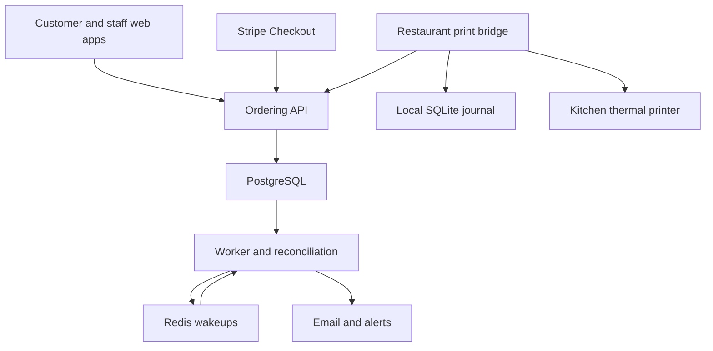

# Wok & Chop — System Architecture

Version 1.0 · 18 November 2026 · Proposed implementation baseline

The local delivery extension uses a separate PostgreSQL ledger with immutable contact, address and price snapshots. Versioned manager transitions and their audit events commit together. The existing restaurant session authorizes account history and manager access. [Local home delivery](docs/LOCAL-DELIVERY.md)

This document describes a production-oriented online ordering system for **Wok & Chop**, the owner-described Halal Hakka Chinese restaurant at **790 Kanata Ave, Unit M2A, Kanata ON**. It is a design, not an implemented or verified live system. Read [PRD.md](PRD.md) for product scope, [SRS.md](SRS.md) for testable requirements, [ARCHITECTURE-ESSENTIALS.md](ARCHITECTURE-ESSENTIALS.md) for a short orientation, and [AGENT.md](AGENT.md) for implementation instructions.

## 1. Architectural decisions

| Decision | Baseline and reason |
| --- | --- |
| Application structure | Modular monolith with separately deployed API, background worker, and restaurant print bridge. One location does not need independently distributed business microservices. |
| Language | TypeScript throughout the web, API, worker, and bridge. Validate external data at runtime; types alone are insufficient. |
| Web | Next.js for public website, ordering, order tracking, staff dashboard, and kitchen display system (KDS). Responsive web, not native apps, initially. |
| Backend | NestJS REST API, shared domain services, generated OpenAPI contract. UI cannot bypass business rules. |
| System of record | PostgreSQL for orders, money snapshots, reservations, events, jobs, and audit history. |
| Background execution | Redis/BullMQ for low-latency wakeups and bounded retries. Persist authoritative work in PostgreSQL so loss of Redis does not lose orders. |
| Payments | Stripe-hosted Checkout, one-time CAD payments, immediate capture; cards and eligible card wallets initially. No Stripe Connect marketplace. |
| Printing | Always-on Linux bridge, SQLite journal, outbound HTTPS, qualified wired 80 mm thermal printer. ESC/POS or vendor SDK selected after hardware testing. |
| Alternative printing | A qualified CloudPRNT adapter may replace the bridge path if the actual printer supports it. Implement one production route first. |
| Fulfillment | ASAP and scheduled pickup at launch; delivery is disabled until service rules and operations are separately approved. |
| Acceptance | Automatically accept a verified paid order if its reservation and operating rules remain valid. Exceptions require staff resolution. |
| Time | Persist UTC instants; apply restaurant rules and display times in `America/Toronto`, including daylight saving changes. |
| Versions | Pin supported framework, runtime, database, Stripe SDK/API, printer firmware, and driver versions during implementation. No unspecified “latest” in deployment. |

The system can ensure one logical original kitchen ticket per order revision and station. It cannot guarantee exactly one physical piece of paper under every device/network failure. Lost acknowledgments must become visible exceptions rather than automatic duplicate cooking instructions.

## 2. Deployment and trust boundaries

The diagram shows dependencies, not permission to access all data. The bridge pulls only jobs assigned to its location and station. It never receives database credentials, Stripe secret keys, or arbitrary shell commands. The printer is reachable only on the restaurant LAN; do not expose a raw printer port to the internet. A staff tablet is a control surface, not the sole durable order store.

Deploy public web assets behind a CDN. Run API and workers on managed containers or an equivalent always-available platform with sufficient timeout and scheduling guarantees. Use managed PostgreSQL with point-in-time recovery, managed Redis, object storage for menu images, a transactional email provider, and centralized logs/metrics. Canadian hosting is a preference to evaluate with privacy requirements, not a claim that every processor keeps all data in Canada. Document all subprocessors and regions.

At the restaurant provide wired networking where possible, a fixed DHCP reservation for the printer, stable power, thermal rolls, a staff KDS device, and a restartable bridge service. A UPS and backup internet are operational options to assess. The website does not implement offline card charging.

## 3. Modules and ownership

| Module | Responsibilities | Owns authoritative changes to |
| --- | --- | --- |
| Catalog | Categories, item variants, modifier groups, availability, display content | Menu and catalog version |
| Pricing | Server quotes, taxes, discount allocation, optional gratuity, rounding | Quote and monetary snapshot |
| Availability | Hours, holiday closures, pause switch, stock, slot capacity | Capacity/stock reservations |
| Ordering | Order aggregate, lifecycle, immutable revisions, kitchen acknowledgement | Fulfillment and order history |
| Payments | Stripe sessions, verified settlement, refunds, reconciliation | Payment attempts and financial ledger |
| Printing | Routing, ticket rendering, job leases, delivery evidence, reprints | Print jobs and attempts |
| Operations | KDS, manager exceptions, channel health, configuration | Operational decisions and overrides |
| Identity | Staff sessions, roles, device credentials, guest tracking access | Authorization and session records |
| Notifications | Customer receipt/status delivery, staff incident delivery | Notification attempts |
| Reporting | Sales/refund/tax projections and reconciliation exports | Read models, never base order balances |

Modules communicate through application services and durable events. A module cannot directly set another module’s statuses to bypass an invariant. Reporting and analytics consume snapshots; they do not recalculate historic orders from the current menu.

## 4. Data model

All identifiers below are internal opaque UUIDs unless explicitly described as human-readable. Every business record includes `location_id`, timestamps, and an optimistic version where updates can conflict. Phase 1 has one location; this is isolation and future compatibility, not a multi-tenant marketplace.

| Entity | Important fields and rules |
| --- | --- |
| `locations` | Name, address, `America/Toronto`, CAD, hours, exceptions, ordering pause, tax profile version, printer routes |
| `menu_items`, `variants`, `modifier_groups`, `modifier_options` | Active state, descriptions, kitchen names, price cents, min/max selections, mutual exclusions, allowed item mappings, tax classification |
| `availability_buckets` | Slot/service date, capacity units, reserved/committed counters; configurable item workload weights |
| `stock_levels` | Optional finite available quantity per configured item; sold-out toggle remains available without ingredient inventory |
| `quotes` | Cart fingerprint, normalized lines, rule versions, integer totals, `expires_at`; valid for 5 minutes before checkout creation |
| `reservations` | Attempt, bucket/stock quantities, deadline, RESERVED/COMMITTED/RELEASED; release requires provider reconciliation |
| `orders` | Internal ID, unique display number, fulfillment state, payment summary, canonical payment ID, pickup promise, prep release time, active revision, guest token hash |
| `order_revisions` | Immutable item names, quantities, prices, options, notes, tax/discount allocations, customer-visible totals; paid revision is never overwritten |
| `order_events` | Transition, prior/new state, actor, reason, server timestamp, source event and correlation ID |
| `payment_attempts` | Order/revision, provider session/intent IDs, CREATING/OPEN/PROCESSING/SUCCEEDED/FAILED/EXPIRED, expected amount, idempotency key, request hash |
| `refunds` | Provider ID, operation ID, amount/allocation, PENDING/SUCCEEDED/FAILED, reason, initiator and latest provider status; canceled provider refunds map to FAILED with cancellation reason |
| `webhook_inbox` | Unique provider event ID, received time, type, signature verification result, restricted payload/ref, processing attempts and outcome |
| `outbox_events` | Unique business event key, versioned payload, delivery state, next attempt; inserted in the same transaction as the business change |
| `printers`, `devices` | Station, model/driver/firmware, supported completion evidence, device identity, heartbeat and health, revoked flag |
| `print_jobs` | Stable job ID, order/revision/station/type, payload hash, template version, due time, status, lease owner/fence, original reference, copy index |
| `print_attempts` | Attempt ID, fence, timestamps, bytes-may-have-been-sent flag, evidence level, device response, error category |
| `kitchen_acknowledgements` | Order/revision, actor, method PAPER/KDS, acknowledged time; independent from printer transport status |
| `exceptions` | Financial/fulfillment/printing type, severity, owner, resolution, links to order/payment/job; does not always replace fulfillment state |
| `staff`, `roles`, `audit_events` | Named users, role mapping, sensitive actions, configuration before/after summaries; no secrets in audit |
| `notification_deliveries`, `consent_records` | Template/event key, provider reference, delivery outcome; optional marketing permission evidence separately |

Minimum database constraints:

- Unique Stripe event ID, Checkout Session ID, PaymentIntent ID where present, and refund provider ID.
- At most one active payment attempt per order across CREATING, OPEN, and PROCESSING; a declined card within an OPEN session does not create a second session.
- One canonical successful payment per order. Preserve and investigate additional successes; never discard evidence of money received.
- Unique original production ticket key `(order_id, revision, station_id, ticket_type)` using a constraint that excludes intentional reprint copies.
- Unique public display number per location/business date; UUID remains the primary key. Number allocation is database-safe, never `count + 1`.
- Unique operation/idempotency key within actor/scope plus request hash. A reused key with a different request returns conflict.
- Nonnegative quantities/amounts and allowed currency; enforce refund budget under an order/payment row lock, not only a check constraint.
- An immutable `job_id` maps to exactly one payload hash. A changed payload requires a new revision/job.

Use row locks or serializable transactions with bounded retry around reservations, payment acceptance, refunds, and dispatch/cancellation races. Do not hold a database transaction open while calling Stripe or a printer.

## 5. Money, taxes, and customer totals

Use integer CAD cents for stored money and decimal/rational arithmetic for percentage calculations. Do not use binary floating-point accumulation. The server loads prices and rules by identifier; the browser supplies desired choices, never trusted final amounts.

`payable = items + modifiers - allocated discounts + fees + tax + voluntary_tip`

The precise taxable base, discount allocation, tax grouping, rounding method, and refundable allocations are versioned configuration approved against accountant-provided examples. Default proposal: deterministic largest-remainder discount allocation, half-up cent rounding at the approved tax grouping level, with totals cross-checked against line allocations. Do not silently mix line and invoice rounding.

CRA lists Ontario’s standard HST rate as 13%, but qualifying low-value prepared-food transactions may receive a point-of-sale rebate; voluntary tips and mandatory service charges also require different treatment. Consequently, a blanket `total * 0.13` implementation is inadequate. See [CRA rates](https://www.canada.ca/en/revenue-agency/services/tax/businesses/topics/gst-hst-businesses/charge-collect-which-rate.html), [prepared-food rebate](https://www.canada.ca/en/revenue-agency/services/forms-publications/publications/gi-064/harmonized-sales-tax-ontario-point-sale-rebate-on-prepared-food-beverages.html), and [special cases](https://www.canada.ca/en/revenue-agency/services/tax/businesses/topics/gst-hst-businesses/charge-collect-special-cases.html).

Store gross tax, rebate where applicable, collected tax, rule version, and line allocations. Customer receipt presentation must follow the approved tax format. Stripe Checkout must show the same final total as the immutable order snapshot. Choose one tax calculation authority; if Stripe Tax is selected later, qualify its exact Canadian classifications and rebate behavior rather than calculating tax twice. Do not let the customer independently change coupons, quantities, tax, shipping, or tips inside hosted Checkout after the snapshot is locked. Configure only supported line/tax presentation that passes totals reconciliation.

Example arithmetic is test data, not Wok & Chop pricing: discounted taxable food of CAD 30.00 at a confirmed 13% profile produces CAD 3.90 tax; adding a voluntarily selected CAD 3.00 tip yields CAD 36.90 under that profile. Separate fixtures cover rebate eligibility, modifiers, discounts, rounding, and partial refunds.

## 6. Checkout and reservation protocol

1. `POST /quotes` validates the menu version, chosen modifiers, current availability, contact format, fulfillment mode, and desired time. It computes totals and returns a quote ID and 5-minute expiration. Cart state alone does not reserve kitchen capacity.
2. `POST /checkout-sessions` receives quote ID and application idempotency key. In a short transaction, revalidate the quote and relevant availability, reserve capacity/finite stock atomically, snapshot the order, and persist a CREATING attempt with stable Stripe idempotency key.
3. Outside the transaction, create the Stripe Session from this exact snapshot. Store only internal order/attempt references in metadata, never allergy notes or unnecessary contact details.
4. Persist the returned session/intent linkage and mark OPEN. Return the hosted checkout URL. If Stripe creation times out, retain CREATING and recover by retrying the same key and parameters. A second request returns the existing operation, not a new payment opportunity.
5. A failed card within an open Session is an attempt event, not proof the Session is terminal. The customer can retry the same hosted session. Do not release its reservation prematurely.
6. A worker expires abandoned sessions, retrieves authoritative provider status, and then releases unpaid reservations. If provider status is unavailable, conservatively retain the reservation and raise a reconciliation alert. Expired local timestamps do not prove payment did not occur.

The frozen quote is valid for the active payment attempt once checkout is created; its original 5-minute pre-checkout deadline no longer invalidates an otherwise legitimate payment. Proposed session lifetime is 30 minutes, aligned with reservation rules. Stripe documents an `expires_at` range of 30 minutes to 24 hours; verify the pinned API at implementation. [Checkout Session creation](https://docs.stripe.com/api/checkout/sessions/create).

**ASAP promise:** show a preparation-time estimate measured from successful payment acceptance, then confirm the actual pickup promise on acceptance. The reservation engine holds conservative workload across the allowed payment window and prevents capacity oversubscription; if this is too restrictive, shorten the business payment window through explicit expiration and qualification, not an unsupported API expiry value.

**Scheduled promise:** only offer slots allowing the full checkout window plus configured preparation lead and safety buffer. Payment must be reconciled before the prep cutoff. Persist `pickup_at`, `prep_release_at`, and `pay_by_at`; show the exact local date/time to the customer. Reject nonexistent DST local times and disambiguate repeated times with offsets.

Do not start sessions that extend beyond the permitted service payment deadline. An emergency closure or staff pause prevents new sessions and starts expiration/reconciliation for open ones. A race in which money arrives after the business can no longer honor the order enters a visible fulfillment EXCEPTION with no unattended KOT; contact/refund resolution follows. Do not automatically claim payment failed.

## 7. Stripe event processing and reconciliation

Hosted Checkout reduces direct handling of card data; the restaurant still has payment-security responsibilities. Never store card numbers or CVC. [Stripe security guide](https://docs.stripe.com/security/guide).

### Webhook ingress

The endpoint reads raw request bytes, validates Stripe’s signature using the correct environment secret, checks expected account/mode and allowed event type, and inserts the event into `webhook_inbox`. Return `2xx` only after durable inbox commit; duplicates already recorded receive `2xx`. Reject invalid signatures; database failure returns a retryable non-success. Do no printing or email delivery in the request handler. Target webhook acknowledgment p95 under 2 seconds.

Stripe advises signature validation, prompt acknowledgment, and duplicate/out-of-order event handling. Our inbox and workers implement these constraints. [Stripe webhooks](https://docs.stripe.com/webhooks).

### Canonical verification and acceptance

For `checkout.session.completed`, retrieve/verify linked Session and PaymentIntent state. Require the expected mode/account, internal references, CAD currency, exact amount, and `payment_status = paid` with a successful canonical payment. Online zero-value/free orders are outside the initial flow. Never interpret a redirect, client payload, or authorization-only state as paid.

Subscribe to relevant session expiration, payment failure, refund, and dispute changes for visibility. Handle asynchronous success/failure safely if delivered, but leave delayed payment methods disabled in Phase 1. Additional success events must converge on the same acceptance function; there is no second fulfillment path. [Stripe fulfillment](https://docs.stripe.com/checkout/fulfillment).

The worker then locks the order/attempt and reservation:

1. If the same payment was applied already, return its existing result.
2. If another payment is canonical, record an additional-payment exception and block a second KOT; preserve the current cooking state.
3. If money is verified but reservation/service checks fail, record PAID and fulfillment EXCEPTION, notify staff, and retain the reconciliation history. Create the customer payment-received receipt independently, clearly saying restaurant review is required and no pickup promise is accepted yet.
4. Otherwise mark payment PAID, commit reserved capacity/stock, transition to ACCEPTED or SCHEDULED, and write acceptance, receipt, and kitchen-release outbox events in one transaction.
5. For ASAP create the durable original print job in that transaction or through an idempotent outbox consumer. For scheduled orders persist release intent and due time, not a volatile timer alone.

There is no distributed transaction with Stripe. Recovery bridges the gap using persisted intents, provider idempotency, and reconciliation. Stripe’s idempotency retention is not a permanent business deduplication ledger; preserve application operation keys and provider references independently. [Stripe idempotent requests](https://docs.stripe.com/api/idempotent_requests).

Every minute, sweep unprocessed inbox events, CREATING/OPEN/PROCESSING attempts due for reconciliation, paid eligible orders missing release events/jobs, due scheduled orders, and stale print jobs. A separate daily financial reconciliation compares captures, successful refunds, unresolved refunds, disputes, and settlements. Gross order sales are not the same as Stripe payout amount because fees and settlement timing differ. Query with durable cursors and overlap windows, respecting provider rate limits.

## 8. Independent state machines

| Axis | States | Critical rule |
| --- | --- | --- |
| Payment aggregate | UNPAID, PROCESSING, PAID, PARTIALLY_REFUNDED, REFUNDED, FAILED | Based on canonical verified capture and successful refund totals; an old failure cannot reverse PAID. |
| Fulfillment | AWAITING_PAYMENT, ACCEPTED, SCHEDULED, IN_PREPARATION, READY, COMPLETED, CANCELLED, EXCEPTION | Kitchen actions determine preparation; print delivery does not automatically prove cooking started. |
| Refund operation | PENDING, SUCCEEDED, FAILED | Request acceptance is not refund completion. Store provider details separately. |
| Print job | QUEUED, LEASED, SENDING, DELIVERED, CONFIRMED, RETRY_WAIT, UNKNOWN, FAILED, CANCELLED | Evidence controls status; transport delivery is weaker than verified physical completion. |

Normal ASAP route: AWAITING_PAYMENT → ACCEPTED → IN_PREPARATION → READY → COMPLETED. Scheduled route: AWAITING_PAYMENT → SCHEDULED → ACCEPTED at prep release → IN_PREPARATION → READY → COMPLETED. Cancellation is an explicit guarded transition with reason. EXCEPTION can resolve to acceptance, rescheduling, or cancellation only through a recorded business decision. Financial exceptions can coexist with IN_PREPARATION/READY/COMPLETED without changing that fulfillment state.

Refunding a completed meal does not undo its fulfillment history. Cancelling cooking does not prove the customer has been refunded. Keep these facts visible together.

## 9. Reliable automatic kitchen printing

### 9.1 Physical installation

Qualify the actual printer model, interface, paper width, code pages, status reporting, cutter, and firmware. “Thermal” or “ESC/POS compatible” is not enough to assume identical capabilities. The baseline bridge runs as a system service on a dedicated small Linux computer with a persistent disk; an ordinary browser tab must not be required for paid-order printing.

Epson distinguishes command receipt/buffering from actual print processing, and status commands vary by supported model. Our design therefore reports only evidence the adapter can establish. [Epson data processing](https://download4.epson.biz/sec_pubs/pos/reference_en/escpos/data_processing.html) and [status command reference](https://download4.epson.biz/sec_pubs/pos/reference_en/escpos/dle_eot.html).

If using a Star CloudPRNT adapter, map its completion response and error codes carefully: a completion request can represent either success or failure, and features depend on model/firmware. [Star job confirmation](https://star-m.jp/products/s_print/sdk/StarCloudPRNT/manual/en/protocol-reference/http-method-reference/job-confirmation-delete/index.html). CloudPRNT does not remove the need for deduplication, operator alerts, or recovery tests.

### 9.2 Ticket content and rendering

Production KOT contains brand, large order number, service type, pickup date/time, paid marker, item quantities and kitchen names, modifiers under the relevant line, spice preference, allergy/special instructions prominently, ticket revision, station, and small stable job reference. Customer name may be abbreviated. Do not print customer email, full payment data, or unnecessary phone/address on the kitchen ticket.

Customer receipt is a different template: restaurant details, approved tax registration details, items/prices, discounts, taxes, tip, amount paid, order number, payment method summary where available, and pickup instructions when accepted. Email it on verified payment, independently of fulfillment acceptance and printing. Paid exceptions receive payment-received/review wording, not a false confirmed pickup time. A mismatched payment is quarantined and acknowledged using the verified received amount without presenting an incorrect order total as settled. Optional front-counter printing has its own station/job type and cannot create another production cue.

Render from immutable structured snapshots using a versioned template and printer profile. Text wrapping must be tested at physical printable width, not assumed from roll width. Strip escape/control bytes and limit free text before rendering; never embed user strings as printer commands. Use raster rendering or a verified code page for unsupported glyphs. Essential names and allergy notes may not silently disappear during transliteration. Label reprints clearly `REPRINT — COPY N`; cancellation notices clearly `CANCEL — DO NOT PREPARE`. Test long tickets, large quantities, accents, and multiple allergy instructions.

Scheduled orders are visible on KDS immediately. Their production KOT becomes eligible at `prep_release_at`. An optional immediate summary must say `HOLD — DO NOT PREPARE` and use a distinct non-production type; it is disabled by default to avoid confusing kitchen staff.

### 9.3 Lease and dispatch protocol

Use one active bridge per printer and one serialized send stream. Proposed poll interval is 2 seconds; heartbeat every 15 seconds; health becomes stale after 45 seconds. Lease lifetime is 60 seconds with 15-second renewal while safely preparing work. These are configuration defaults to verify on site.

1. Bridge authenticates with a revocable device credential and calls `/v1/device/print-jobs/claim`. Server locks an eligible job, validates type-specific order/revision rules, assigns a monotonic fencing token, and transitions QUEUED → LEASED. Production KOTs require valid acceptance, a verified canonical capture, due release, and no cancellation. Here “paid” refers to verified capture history, not equality with the current PAID enum; refunds remain separate financial facts. A CANCEL notice instead requires an authorized cancellation and a potentially dispatched original, so cancellation must not block its own notice. Receipts and explicitly authorized reprints use their separate eligibility rules and cannot be mistaken for a new original production instruction.
2. Bridge verifies payload hash and persists job ID, fence, and READY_LOCAL state in SQLite with durable commit. If it already has completion evidence for that job, it reports that evidence without sending paper again.
3. Immediately before output, bridge calls `/v1/device/print-jobs/{id}/dispatch-start`. Under a lock the server verifies the current fence, active device, lease, revision, and the same ticket-type-specific eligibility, then records SENDING. Only a successful response authorizes output. Offline execution of newly claimed work is prohibited.
4. Bridge fsyncs its local send-intent record **before** any bytes can reach the printer. It then performs the single serialized send and records the result locally before reporting upstream.
5. On ordinary raw transport success, report DELIVERED with `evidence = transport`. Use CONFIRMED only when the qualified adapter has job-specific completion evidence. Staff kitchen acknowledgement remains a separate event in both cases.
6. Retry upstream reporting from the journal as needed. Reporting the same outcome twice does not send the payload twice.

A lease that expires while still LEASED can be reclaimed only when the server’s dispatch-start gate proves no authorized send began; the old fence can no longer acquire dispatch permission. If server state is SENDING, or a local crash leaves any possibility of output, move to UNKNOWN. Do not reassign it simply because a timeout elapsed. Loss of a dispatch-start response can conservatively produce UNKNOWN even before paper existed; safety is preferable to an invisible duplicate.

### 9.4 Recovery, retries, and manual resolution

| Evidence | Action |
| --- | --- |
| No output attempted, connection refused or paper-out detected before dispatch | RETRY_WAIT; same job and payload; bounded backoff proposed 2, 5, 10, 30 seconds, then alert/park. |
| Output may have started, timeout/disconnect/crash afterward | UNKNOWN; stop automatic resend and show order prominently on staff dashboard. |
| Journal proves successful delivery, cloud ACK lost | Resend the ACK only; never the ticket. |
| Permanent unsupported payload/driver error before output | FAILED, alert; correct configuration and issue an audited controlled retry/new revision as appropriate. |
| Staff finds the original paper | Record resolution and paper acknowledgement. Do not fabricate device CONFIRMED evidence. |
| Staff confirms missing/partial paper | Create a new linked, numbered REPRINT job with actor and reason; mark original resolution without erasing uncertainty history. |
| Bridge disk/journal lost | Revoke device, pause dispatch, reconcile jobs physically with staff before replacement activation. Do not bulk replay. |

Alert after 30 seconds of overdue eligible work; escalate unresolved incidents at 120 seconds. Notification delivery failure itself is visible. Require staff acknowledgement of incident ownership; an email alone is not resolution.

If printer health is lost, pause new checkouts by default. A manager may activate KDS-only fallback for a proposed 30-minute window, with reason, visible banner, healthy KDS heartbeat, and named staff acknowledgment. Existing paid orders stay visible. Staff handling an order through KDS must suppress any safe, undispatched original KOT with audited CANCELLED reason `FULFILLED_VIA_KDS`; UNKNOWN/SENDING jobs require reconciliation first. When printing resumes, never dump stale production tickets for meals already being cooked. An optional archive copy must be explicitly marked non-production.

## 10. Cancellation, order changes, and refunds

Before payment, replace the quote normally. Once a Checkout Session exists, expire/reconcile it before changing the financial snapshot. After payment, Phase 1 does not offer arbitrary self-service item edits. Staff use cancellation/refund/reorder or an explicitly supported, audited non-price note correction; changes affecting kitchen instructions require revision visibility and an amendment notice rather than silently overwriting the printed ticket.

Cancellation and dispatch compete for the same order/job locks. If cancellation wins before dispatch-start, cancel queued/leased jobs and invalidate their fences. If dispatch already started, record that cooking may have begun, create an urgent cancellation notice, and require kitchen acknowledgement. Cancelling the cloud row cannot retract paper from a printer buffer.

Refund request protocol:

1. Verify manager/owner permission, reason, amount and immutable allocation; create a PENDING operation and reserve its refund budget under lock.
2. Enforce `successful_refunds + pending_refunds + requested_amount <= captured_amount`.
3. Call Stripe outside the transaction with stable operation idempotency key. A timeout remains pending/uncertain until reconciliation; do not release the budget and create another refund blindly.
4. Process provider updates monotonically using canonical current status. Payment aggregate changes only for successful refunds. A failed/canceled refund releases reserved budget and creates a staff-visible outcome.
5. Reconcile refunds made directly in Stripe Dashboard into the same ledger. Allocation exceptions are flagged for accountant review.

Stripe supports full/partial refunds and refunds can remain pending or fail. Customer communication must distinguish “refund requested” from “refund completed”; no invented instant bank-credit promise. [Stripe refunds](https://docs.stripe.com/refunds).

## 11. API contract outline

All protected resources use server authorization, not only UI hiding. JSON schemas reject unknown sensitive fields. Mutation requests carry `Idempotency-Key` where specified and `expected_version` for conflicting staff edits. Return structured errors `{code, message, correlation_id, details}` with safe customer wording.

| Method/path | Purpose and authorization |
| --- | --- |
| `GET /v1/menu`, `/v1/availability` | Published menu and ordering slots; public, rate limited |
| `POST /v1/quotes` | Normalize choices and compute server totals; guest session |
| `POST /v1/checkout-sessions` | Reserve and create/recover Checkout; guest session + idempotency key |
| `GET /v1/orders/{id}` | Minimal customer view using guest tracking session; order ID alone is insufficient |
| `POST /v1/order-access/exchange` | Exchange high-entropy one-time tracking link for a secure limited session |
| `POST /v1/payments/stripe/webhook` | Raw body signature verification; exempt from browser CSRF but not verification |
| `GET /v1/staff/orders`, `/events` | Staff queue and authorized SSE updates; versioned reconnect cursor |
| `POST /v1/staff/orders/{id}/transitions` | Guarded prepare/ready/complete/cancel action with reason where required |
| `POST /v1/staff/orders/{id}/refunds` | Manager/owner; stable idempotency key; pending response if provider unresolved |
| `POST /v1/staff/print-jobs/{id}/reprints` | Manager-authorized copy with reason; no new payment |
| `POST /v1/staff/exceptions/{id}/resolve` | Specific allowed resolution, audit and expected version |
| `PATCH /v1/staff/menu/{id}`, `/v1/staff/settings` | Authorized catalog/availability changes; finance/device settings owner restricted |
| `POST /v1/device/heartbeat` | Device-scoped health and capabilities |
| `POST /v1/device/print-jobs/claim` | Scoped printer lease; no arbitrary order access |
| `POST /v1/device/print-jobs/{id}/dispatch-start` | Fence and cancellation check immediately before output |
| `POST /v1/device/print-jobs/{id}/ack` | Idempotent evidence upload, not implicit physical confirmation |

Use `409` for changed price/availability or stale versions, `422` for invalid selections, `429` for rate limiting, and retryable `503` for unavailable dependencies. Do not include raw Stripe errors or printer credentials in customer responses. SSE falls back to bounded polling; it is not a durable event bus.

## 12. Security, privacy, and content controls

- Staff use named accounts, strong authentication, MFA for managers/owners, secure HttpOnly cookies, CSRF protection for browser mutations, idle expiration, and role checks on every operation.
- Kitchen role sees preparation data and can update permitted fulfillment states; it cannot refund, export customer lists, change payment keys, or manage users. Cashier can manage service workflow but refund privilege remains explicitly granted.
- Guest tracking uses high-entropy tokens stored hashed, exchanged for short-lived sessions, scrubbed from logs and referrers. Disable third-party analytics on token-bearing/tracking pages. Provide a rate-limited email recovery flow with non-enumerating responses.
- Rate limit checkout, access recovery, staff login, and device endpoints. Use abuse controls without making the menu inaccessible. Enforce maximum cart quantity, order value, note length, payload size, and allowed uploaded image MIME/content.
- Encrypt transport and managed storage/backups. Keep secrets in the deployment secret manager. Rotate and revoke bridge credentials; prefer mTLS if operationally supportable. Never put keys in frontend bundles.
- Do not store raw card data. Restrict webhook payload retention and access because payloads may contain contact data. Logs use internal IDs and redacted errors.
- Public claims about halal standards, certifications, “Ottawa’s first,” ingredient provenance, and allergens require owner-supplied approved content. Halal positioning does not imply allergen-free preparation. Do not invent certifications or guarantee no cross-contact.
- Define retention separately for financial records, operational contact data, kitchen notes, bridge payloads, logs, and backups. Proposed minimization: purge local ticket payloads 24 hours after closed-job reconciliation, keep minimal deduplication IDs/hashes longer under an approved schedule. Legal holds and restore procedures must respect deletion obligations. No fixed statutory retention period is assumed here.
- Provide privacy notice, contact route, access/correction/deletion workflow and processor inventory. Validate applicable privacy obligations using [OPC PIPEDA guidance](https://www.priv.gc.ca/en/privacy-topics/privacy-laws-in-canada/the-personal-information-protection-and-electronic-documents-act-pipeda/).
- Marketing is separately opted in and disabled by default. Keep transactional order messages free of unrelated promotions. Validate any later marketing consent, identification, and unsubscribe flow against [CRTC CASL guidance](https://crtc.gc.ca/eng/com500/guide.htm).
- Target [WCAG 2.2 AA](https://www.w3.org/TR/WCAG22/) as a product quality requirement. Ontario legal website obligations have scope conditions; confirm applicability rather than claiming every small business is subject to the same threshold. [Ontario website accessibility](https://www.ontario.ca/page/how-make-websites-accessible).

## 13. Observability and service targets

All following numbers are proposed acceptance targets, not measured current performance.

| Measure | Target and denominator |
| --- | --- |
| Ordering API availability | 99.9% monthly; document planned maintenance and dependency impact separately |
| Quote API | p95 under 500 ms at assumed 100 concurrent sessions and 20 checkout creations/minute |
| Webhook durable acceptance | p95 under 2 seconds excluding provider delivery latency |
| Healthy ASAP print delivery | 95% within 10 seconds from verified payment acceptance to qualified adapter acknowledgement; explicitly label transport vs device evidence |
| Scheduled release | Worker checks due work at least once/minute; dispatch latency measured from eligibility, not purchase time |
| Print overdue alert | 30 seconds; unresolved escalation 120 seconds |
| Bridge health | Heartbeat 15 seconds; offline after 45 seconds |
| Reconciliation | Payment/job sweeps each minute; daily settlement review |
| Recovery objectives | RPO ≤ 5 minutes, RTO ≤ 60 minutes; prove via restore drills |

Sizing hypothesis: 300 paid orders/day and 30 paid orders per peak 15 minutes. Measure actual demand before setting capacity limits or hardware counts. Load tests must include webhook bursts, large tickets, scheduled release bunching, and provider/queue outages, not merely menu page requests.

Correlate request ID, order ID, payment attempt, Stripe event, outbox event, print job, device, and kitchen acknowledgement. Dashboards show paid-but-unaccepted orders, oldest unprocessed inbox/outbox event, pending refunds, printer health, UNKNOWN jobs, overdue kitchen acknowledgement, and unresolved financial mismatches. Track whether notifications were delivered and acknowledged. Never include full customer notes in metric labels.

## 14. Failure and recovery runbook

| Failure | Required behavior |
| --- | --- |
| Customer closes tab after payment | Webhook/reconciliation accepts order and releases KOT without needing the return page. |
| Stripe/API uncertainty during Session creation | Keep stable operation and reservation; recover same request, show processing state. |
| Duplicate or reordered event | Unique inbox record plus semantic idempotency; no state regression or second original job. |
| API/DB unavailable during webhook | Return non-success, provider retries; sweep after recovery. No payment success invented locally. |
| Redis lost | Rebuild execution wakeups from PostgreSQL; duplicates safe through business uniqueness. |
| Worker crashes after acceptance commit | Outbox and missing-job sweep recover the work. |
| Printer paper empty before output | Queue stays durable; alert, bounded safe retry, pause new checkout unless explicit staffed fallback. |
| Power lost during output | UNKNOWN; inspect paper and journal, controlled reprint if required. |
| Restaurant internet lost | New checkout pauses after stale health threshold; in-flight payment races handled as exceptions; staff continue only verified existing orders under fallback. |
| Email unavailable | Retry notification, keep customer tracking and staff queue working; never reverse payment or trigger another print. |
| Refund request timed out | Preserve pending budget; reconcile before another request. |
| Database restored from backup | Freeze checkout/dispatch first; reconcile provider transactions and bridge journals before rebuilding work. |

**Restore sequence:** pause new payment sessions and all printer dispatch; restore PostgreSQL and keys/configuration from controlled backups; reconcile provider captures/refunds after the recovery point using overlap windows; compare cloud print jobs with surviving bridge journals and staff records; quarantine ambiguous jobs; restore capacity and scheduled commitments; re-create only proven missing logical work; run a test ticket; resume with manager awareness. Never replay the entire restored outbox into printers blindly. RPO permits a data gap; reconciliation reduces its business impact but cannot magically prove all physical outputs.

At shift opening: verify operating hours, menu availability, KDS session, device heartbeat, paper and a test ticket. At shift closing: reconcile paid orders, unresolved tickets/refunds, upcoming scheduled orders, and pause/closing rules. Appoint a shift manager as the first response owner and an engineer for infrastructure escalation.

## 15. Build sequence and production gates

1. Validate printer hardware/protocol on a bench, plus Stripe sandbox webhook acceptance; prove a paid test order can become a real ticket before polishing the full site.
2. Implement domain schema, money/availability rules, immutable order snapshots, checkout and acceptance transaction.
3. Implement inbox/outbox/worker reconciliation and failure injection.
4. Implement bridge enrollment, journal, fencing/dispatch gate, physical KOT layout, status reporting and UNKNOWN resolution.
5. Complete mobile customer journey, staff/KDS workflow, receipts, cancellation/refund and reporting.
6. Exercise concurrency, security, accessibility, backup recovery, scheduled/DST cases, and live hardware outage drills.
7. Obtain owner menu/hours/policies/claim approvals, accountant tax examples, merchant onboarding, and operational staff training. Run a limited pilot, then open full ordering after critical acceptance tests pass.

Required handover: deployed-source commit, environment inventory without secret values, OpenAPI schema, migrations, hardware/firmware qualification record, incident runbooks, tested restore evidence, staff guide, and acceptance report. No mock payment success or simulated printer ACK may be enabled in production.

## 16. Source notes and unresolved decisions

Official references linked above were reviewed on 18 November 2026. They establish external integration behavior and regulatory context; the architecture, intervals, thresholds and scope are proposed project decisions. Recheck official docs against pinned dependencies before implementation.

Owner decisions still needed before launch: exact menu/options/photos; hours and last-order rules; contact and tax-registration details; actual printer model/interface; existing POS integration expectations; capacity/prep estimates; cancellation/refund policy; tip policy; delivery scope; notification channels; hosting/support budget; retention and privacy owner; approved public brand/halal statements. Existing POS synchronization is not included unless explicitly scoped, so inventory/capacity changes must have an identified staff owner.
